  

Electrical engineer focused on embedded systems and automation.

  <a href="https://github.com/nuttyuwu/lilith-desktop">Lilith Desktop</a> &nbsp; · &nbsp;
  <a href="https://github.com/nuttyuwu?tab=repositories">my projects</a> &nbsp; · &nbsp;
  <a href="https://github.com/nuttyuwu/lilith-desktop/releases/latest">bring Lilith home</a>

### a little about me

I'm an Electrical engineer focused on embedded systems and automation. I build practical tools that connect hardware and software, alongside personal projects like Lilith.

### ♡ currently keeping me company

**[Lilith Desktop](https://github.com/nuttyuwu/lilith-desktop)** — an unofficial desktop companion with original game animations and voice, Claude Code reactions, music controls, and a little sparkle when she tucks away.

built around the pet i liked, with more ways to interact. character assets come from your own installed copy of the game.

[download setup](https://github.com/nuttyuwu/lilith-desktop/releases/latest) · [take a look around](https://github.com/nuttyuwu/lilith-desktop#readme)

✦ see Lilith in motion

 

 
A staged animation showcase. Open the project README for the controls and setup details.

### other things on my desk

| project | what it is |
| :--- | :--- |
| [MN AutoCAD Translator](https://github.com/nuttyuwu/cnmn-translator-customer) | customer installer for the AutoCAD translation tool |
| [ESP32 Dehydrator](https://github.com/nuttyuwu/esp32-dehydrator) | firmware for a hybrid solar-electric food dehydrator |
| [Lilith AI](https://github.com/nuttyuwu/lilith_ai) | a separate AI companion experiment |

around here: JavaScript · Python · C/C++ · PowerShell · Electron · ESP32

 

thanks for stopping by. leave a little room on your desktop for company. ✦

